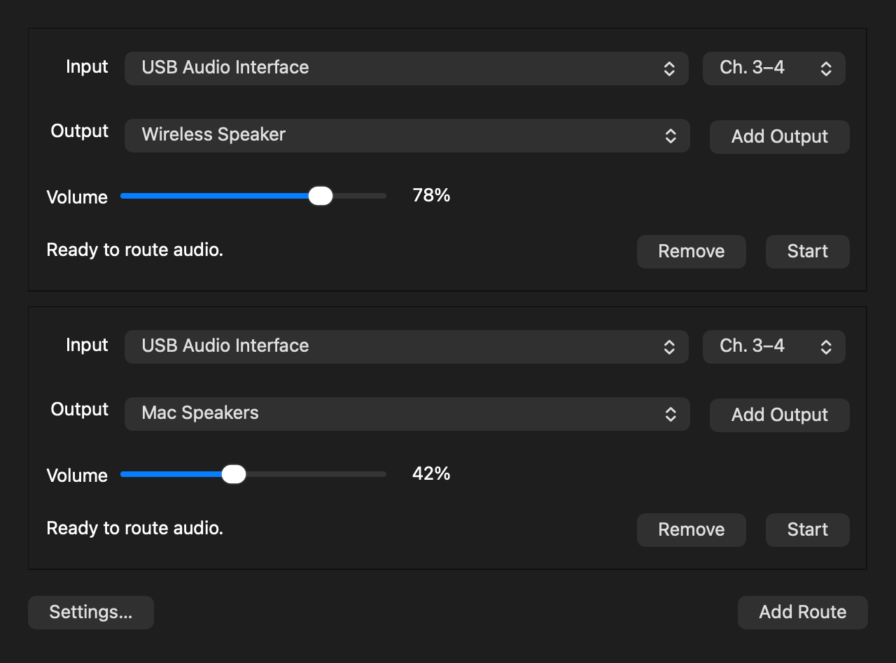

# Aux Bridge

**Play audio from your Mac’s inputs through the speakers or headphones you choose.** Aux Bridge is a low-latency menu bar app for macOS.

[**Get Aux Bridge**](https://github.com/Feverqwe/aux-bridge/releases) · Apple Silicon · macOS 14.4 or later

Release downloads are ad-hoc signed. If macOS asks you to approve the app the first time you open it, see [Apple’s instructions for opening a downloaded app](https://support.apple.com/en-us/102445).

  

## Your audio, where you want it

- Send a monitor’s AUX signal from a USB audio interface to a Bluetooth speaker without changing your Mac’s system output.
- Use **Add Output** to send one input to another device, or run separate routes side by side.
- Start, stop, and adjust the volume of each route independently. Closing the window keeps your routes running.

## Start listening

1. Choose an **Input** and **Output**.
2. Click **Start** and allow microphone access when macOS asks. The same permission covers external inputs.
3. Click **Add Route** to set up another connection.

For a device with more than two channels, use its channel menu to pick the input or output you want.

Bluetooth devices add their own playback delay.

In **Settings**, choose where to show the app icon. You can use the menu bar, the Dock, or both.

[Build from source](docs/build.md)
